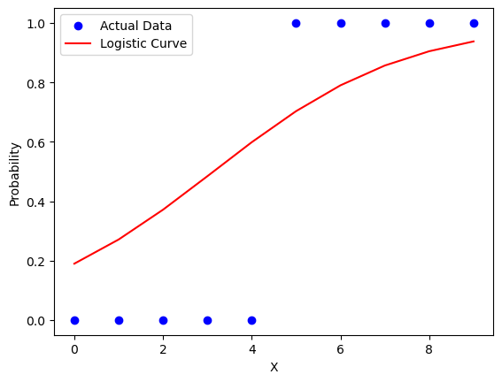

# Implementation-of-Logistic-Regression-Using-Gradient-Descent

## AIM:
To write a program to implement the the Logistic Regression Using Gradient Descent.

## Equipments Required:
1. Hardware – PCs
2. Anaconda – Python 3.7 Installation / Jupyter notebook

## Algorithm
1. Import the required libraries.
2. Load the placement dataset, convert the target variable (Placed/Not Placed) into numeric form(1/0).
3. Select the features and scales them using StandardScaler.
4. Add a bias term to the feature matrix, define the sigmoid and cost functions, and initialize the model parameters (weights) and learning rate.
5. Apply gradient descent iteratively to update the weights by minimizing the cost function.
6. Use the trained model to predict class labels and calculate the classification accuracy.
7. Plot the cost function versus the number of iterations to visualize convergence.

## Program:
```
/*
Program to implement the the Logistic Regression Using Gradient Descent.
Developed by: Jayapriya P
RegisterNumber: 212225040144
*/
```
```
/*
 import numpy as np
import matplotlib.pyplot as plt

# Sample dataset
X = np.array([0,1,2,3,4,5,6,7,8,9])
Y = np.array([0,0,0,0,0,1,1,1,1,1])

# Initialize parameters
w = 0
b = 0

learning_rate = 0.01
epochs = 1000
n = len(X)

# Sigmoid function
def sigmoid(z):
    return 1 / (1 + np.exp(-z))

# Gradient Descent
for i in range(epochs):

    # Linear model
    z = w * X + b

    # Prediction
    y_pred = sigmoid(z)

    # Gradients
    dw = (1/n) * np.sum((y_pred - Y) * X)
    db = (1/n) * np.sum(y_pred - Y)

    # Update parameters
    w = w - learning_rate * dw
    b = b - learning_rate * db

print("Weight:", w)
print("Bias:", b)

# Predictions
z = w * X + b
prob = sigmoid(z)

plt.scatter(X, Y, color="blue", label="Actual Data")
plt.plot(X, prob, color="red", label="Logistic Curve")
plt.xlabel("X")
plt.ylabel("Probability")
plt.legend()
plt.show()
*/
```

## Output:




## Result:
Thus the program to implement the the Logistic Regression Using Gradient Descent is written and verified using python programming.

